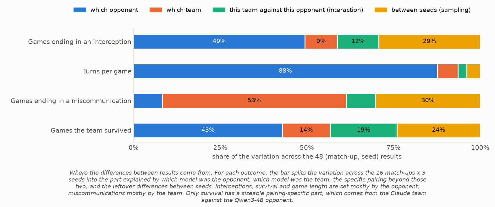
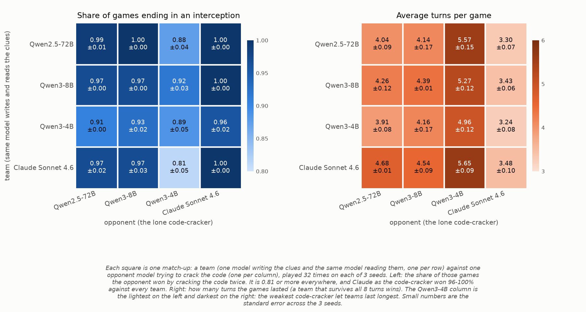
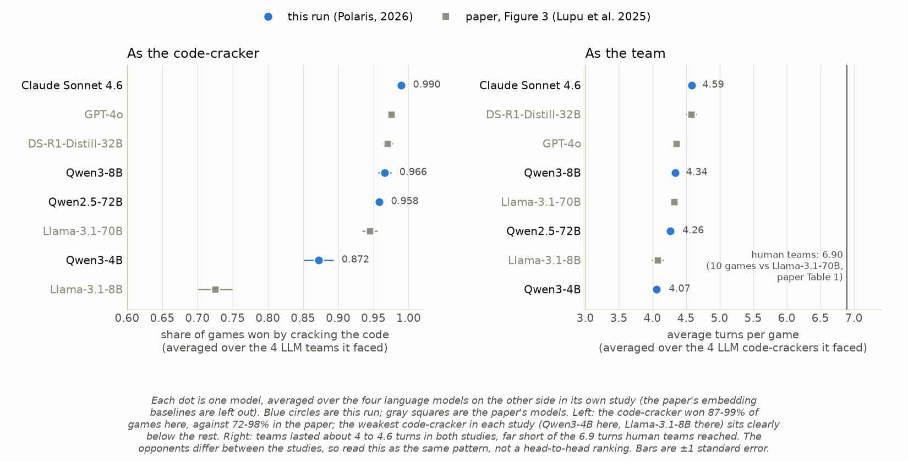

# Results: Decrypto competitive play with a four-model roster on Polaris

All numbers not tagged UNVERIFIED were computed by
`analysis/plot_polaris_4model_competitive.py` in PBS job 7731552 (debug queue). Its full
report is `logs/analysis/polaris_4model_competitive_7731552.txt`, and the figures are in
`results/polaris_4model_competitive/figures/`. Source data:
`results/polaris_4model_competitive_s{0,1,2}/experiment_summary.csv` (jobs
7668935–7668937). The comparator is Lupu, Willi & Foerster, *The Decrypto Benchmark for
Multi-Agent Reasoning and Theory of Mind*, arXiv:2506.20664v1 (2025), "the paper" below.

## 1. Question and design

We tested whether the paper's competitive result holds for a newer roster of models.
In that result the interceptor wins most games and games last about four turns. We also
asked which factor, the team or the opponent, determines each game outcome. In
Decrypto an encoder writes three clues for a secret 3-digit code, its decoder must read
them back, and an interceptor (the opponent) tries to crack the same code from the
public clue history. The team loses at two interceptions or two miscommunications and
wins by lasting 8 turns. The experiment was geared towards a like-for-like comparison
with the paper's Figure 3 (bottom row), so we chose the paper's released configuration
(`config/paper/figure_3_competitive.yaml`) and changed only the roster. In that
configuration the same model is both encoder and decoder (a "team") and plays against
every model as the opponent.

Table 1. Design.

| Element | This run | Paper (comparator) |
|---|---|---|
| Arms | 4 teams × 4 opponents = 16 match-ups: Qwen2.5-72B-Instruct, Qwen3-8B, Qwen3-4B, Claude Sonnet 4.6 | 6 × 6: Word2Vec, GloVe, Llama-3.1-8B, Llama-3.1-70B, GPT-4o, DeepSeek-R1-Distill-Qwen-32B |
| Like-for-like comparator | — | the paper's 4 × 4 LLM-only block (embedding baselines excluded) |
| Replicates | 3 seeds (`env_seed` 0, 1, 2) × 32 episodes per match-up = 1,536 games; episode seed = episode + 32 × env_seed, so the keyword and code draws match the paper's | same scheme |
| Sampling | temperature 0.6, `model_seed` 0 for the Qwen models | temperature 0.6, `model_seed` 0 |
| Settings that differ between our arms | Claude ran through the `claude -p` CLI: CLI-default sampling, a flattened `[USER]/[ASSISTANT]` transcript, and a 180 s call timeout. Qwen3-8B and Qwen3-4B reason before answering (2,000-token budget within an 8,192-token context); Qwen2.5-72B does not | — |
| Error history | `no_error_history: false` (released-config default) | same config |
| Human reference | — | Table 1 of the paper: 10 human games against Llama-3.1-70B (UNVERIFIED) |

Derived quantities. The interception share of a (match-up, seed) result is
(games ending in two interceptions + games ending in both limits on the same turn) / 32,
as in the paper's `analysis/comp_cross_4heatmaps.py`. Turns per game is the mean over the
32 games. A match-up value is the mean over the 3 seeds ± the standard error
(SE = SD/√3). A per-model value is the mean of its 4 match-ups, with
SE = √(Σ SE²)/4. Pooled percentages carry 95% Wilson intervals over games. We
partitioned each outcome with a two-way ANOVA with replication over the 48 (match-up,
seed) values. The factors are team, opponent and team × opponent, and the residual is
the between-seed variation. η² is a component's sum of squares divided by the total sum
of squares. Counts were tested with χ² tests of independence on pooled 4 × 2 tables and
two-sided Fisher exact tests. Team game lengths were compared with paired t-tests over
the 12 (opponent, seed) pairs. The between-seed spread was tested against binomial
sampling with a Pearson heterogeneity χ². We report 32 tests; p < 0.0016 survives
Bonferroni correction, and results with 0.0016 ≤ p < 0.05 are marked *nominal*.

We use statistical-genetics terms for the variance structure only. Team and opponent are
additive main effects. The team × opponent term is the non-additive (interaction,
epistasis-like) component. The between-seed term is binomial sampling variance.

## 2. Results

As Table 2 and Figure 1 show, the opponent won almost every game. Interceptions ended
1,454 of 1,536 games (sum of Table 2), a grand-mean interception share of
0.947 ± 0.006. The team survived 44 games (2.9%) and lost 38 (2.5%) to miscommunication.
Games lasted 4.31 ± 0.03 turns. In the paper's LLM-only block the interception share was
0.904 ± 0.007 (UNVERIFIED), lower than ours by 0.043 (z = 4.65, p = 3 × 10⁻⁶). Game length
was 4.33 ± 0.03 turns there (UNVERIFIED), no different from ours (difference −0.02 turns,
z = −0.45, p = 0.65).

Table 2. Results by opponent (pooled over teams and seeds; n = 384 games each).

| Opponent | Interception share [95% CI] | Team survived [95% CI] | Turns of games against it |
|---|---|---|---|
| Qwen2.5-72B | 368/384 = 95.8% [93.3, 97.4] | 7/384 = 1.8% [0.9, 3.7] | 4.22 ± 0.04 |
| Qwen3-8B | 371/384 = 96.6% [94.3, 98.0] | 3/384 = 0.8% [0.3, 2.3] | 4.30 ± 0.06 |
| Qwen3-4B | 335/384 = 87.2% [83.5, 90.2] | 34/384 = 8.9% [6.4, 12.1] | 5.36 ± 0.06 |
| Claude Sonnet 4.6 | 380/384 = 99.0% [97.4, 99.6] | 0/384 = 0.0% [0.0, 1.0] | 3.36 ± 0.04 |

As Table 2 and Table 4 show, the opponent set the interception share. Across opponents,
χ²(3) = 59.8 (p = 6 × 10⁻¹³). In the ANOVA the opponent accounted for η² = 0.49 of the
variation (F(3,32) = 18.0, p = 5 × 10⁻⁷). Qwen3-4B as opponent intercepted 87.2% of games
against 97.1% (1,119/1,152) for the other three opponents (odds ratio 0.20, Fisher
p = 6 × 10⁻¹²). The team effect on the interception share was smaller and nominal:
χ²(3) = 11.4 (p = 0.010), η² = 0.09 (F(3,32) = 3.43, p = 0.029). The team × opponent term was
not detectable (η² = 0.12, F(9,32) = 1.45, p = 0.21).

As Table 4 and Figure 4 show, the opponent also set game length. It accounted for
η² = 0.88 of the variation in turns per game (F(3,32) = 240, p = 5 × 10⁻²²). Games lasted
5.36 ± 0.06 turns against Qwen3-4B and 3.36 ± 0.04 turns against Claude (Table 2). The team
accounted for η² = 0.06 (F(3,32) = 16.6, p = 1 × 10⁻⁶), and the interaction for η² = 0.03
(F(9,32) = 2.30, p = 0.04, nominal).

Table 3. Results by team (pooled over opponents and seeds; n = 384 games each).

| Team | Intercepted | Miscommunicated [95% CI] | Survived [95% CI] | Turns as team |
|---|---|---|---|---|
| Qwen2.5-72B | 371 (96.6%) | 4 = 1.0% [0.4, 2.6] | 9 = 2.3% [1.2, 4.4] | 4.26 ± 0.06 |
| Qwen3-8B | 370 (96.4%) | 8 = 2.1% [1.1, 4.1] | 6 = 1.6% [0.7, 3.4] | 4.34 ± 0.04 |
| Qwen3-4B | 353 (91.9%) | 26 = 6.8% [4.7, 9.7] | 5 = 1.3% [0.6, 3.0] | 4.07 ± 0.06 |
| Claude Sonnet 4.6 | 360 (93.8%) | 0 = 0.0% [0.0, 1.0] | 24 = 6.2% [4.2, 9.1] | 4.59 ± 0.04 |

As Table 3 shows, the team set the miscommunication rate. Across teams, χ²(3) = 42.6
(p = 3 × 10⁻⁹), and the team accounted for η² = 0.53 (F(3,32) = 18.8, p = 3 × 10⁻⁷). The
opponent effect on miscommunication was not detectable (η² = 0.08, F(3,32) = 2.90,
p = 0.05). Qwen3-4B's team miscommunicated in 6.8% of games against 1.0% (12/1,152) for the
other teams (odds ratio 6.9, p = 1 × 10⁻⁸). Claude's team miscommunicated in 0.0% against
3.3% (38/1,152) for the others (p = 3 × 10⁻⁵).

As Table 3 shows, Claude's team lasted longest: 4.59 ± 0.04 turns. Against the same
opponents and seeds that was 0.32 turns more than Qwen2.5-72B (t(11) = 3.71, p = 0.004,
nominal), 0.25 more than Qwen3-8B (t(11) = 3.97, p = 0.002, nominal) and 0.52 more than
Qwen3-4B (t(11) = 5.90, p = 1 × 10⁻⁴). Claude's team survived 6.2% of its games against 1.7%
(20/1,152) for the other teams (odds ratio 3.8, p = 2 × 10⁻⁵).

As Table 4 and Figure 4 show, survival depended on the opponent (η² = 0.43, F(3,32) = 19.1,
p = 3 × 10⁻⁷; χ²(3) = 68.3, p = 1 × 10⁻¹⁴). It also depended on the team (η² = 0.14,
F(3,32) = 6.12, p = 0.002, nominal) and on the pairing (η² = 0.19, F(9,32) = 2.86, p = 0.014,
nominal). The pairing term came from one match-up. Claude's team survived 6.00 of 32
games per seed against Qwen3-4B, where the additive prediction (team mean + opponent mean −
grand mean) was 3.92, a residual of +2.08 games. The next-largest residuals were
−1.08 games (Qwen3-8B's team against Qwen3-4B; Claude's team against Claude).

The spread between seeds within a match-up matched binomial sampling of 32 games.
Pearson heterogeneity was χ² = 25.8 (df 24, p = 0.36) for interceptions, 11.6 (df 16,
p = 0.77) for miscommunications and 22.3 (df 18, p = 0.22) for survival. The ratio of
observed to binomially expected within-match-up variance was 1.17, 0.78 and 1.30
(match-ups at 0% or 100% contribute no degrees of freedom).

As Table 2 and Table 3 show, Qwen2.5-72B and Qwen3-8B did not differ in either role. As
opponents they intercepted 368/384 and 371/384 games (Fisher p = 0.71). As teams they lasted
4.26 and 4.34 turns (paired difference −0.07 turns, t(11) = −0.80, p = 0.44).

Table 5. Per-model averages over the four LLMs on the other side, this run vs the paper
(paper values UNVERIFIED).

| Opponent | Interception share | Team | Turns as team |
|---|---|---|---|
| Claude Sonnet 4.6 | 0.990 ± 0.005 | Claude Sonnet 4.6 | 4.59 ± 0.04 |
| GPT-4o (paper) | 0.975 ± 0.004 | DS-R1-Distill-32B (paper) | 4.58 ± 0.08 |
| DS-R1-Distill-32B (paper) | 0.970 ± 0.008 | GPT-4o (paper) | 4.35 ± 0.04 |
| Qwen3-8B | 0.966 ± 0.009 | Qwen3-8B | 4.34 ± 0.04 |
| Qwen2.5-72B | 0.958 ± 0.005 | Llama-3.1-70B (paper) | 4.32 ± 0.05 |
| Llama-3.1-70B (paper) | 0.945 ± 0.011 | Qwen2.5-72B | 4.26 ± 0.06 |
| Qwen3-4B | 0.872 ± 0.021 | Llama-3.1-8B (paper) | 4.08 ± 0.09 |
| Llama-3.1-8B (paper) | 0.725 ± 0.024 | Qwen3-4B | 4.07 ± 0.06 |

As Table 5 and Figure 2 show, each study had one weakest opponent: Qwen3-4B here
(0.872 ± 0.021) and Llama-3.1-8B in the paper (0.725 ± 0.024, UNVERIFIED). With each
study's weakest opponent removed, the interception shares were 0.971 ± 0.004 here and
0.963 ± 0.005 in the paper (UNVERIFIED), a difference of +0.008 (z = 1.32, p = 0.19). The
longest-lasting team was Claude here (4.59 ± 0.04 turns) and DS-R1-Distill-32B in the paper
(4.58 ± 0.08, UNVERIFIED). Human teams in the paper lasted 6.90 turns and won 40% of
10 games against Llama-3.1-70B (UNVERIFIED).

## 3. Sweeps and ablations

No parameter was swept and no ablation was run. Temperature, the Claude transport,
the Qwen3 reasoning budget and the error-history setting were held fixed. The only
variation is the 4 × 4 factorial of teams and opponents, and every one of its 16
match-ups is reported (Appendix A). Table 4 and Figure 4 say which component carries
each outcome:

Table 4. Variance partition (two-way ANOVA over 48 match-up × seed values; η² = share of the total sum of squares).

| Outcome | Opponent η² (F(3,32), p) | Team η² (F(3,32), p) | Team × opponent η² (F(9,32), p) | Between seeds η² |
|---|---|---|---|---|
| Interception share | 0.49 (18.0, 5 × 10⁻⁷) | 0.09 (3.43, 0.029) | 0.12 (1.45, 0.21) | 0.29 |
| Turns per game | 0.88 (240, 5 × 10⁻²²) | 0.06 (16.6, 1 × 10⁻⁶) | 0.03 (2.30, 0.04) | 0.04 |
| Miscommunication share | 0.08 (2.90, 0.05) | 0.53 (18.8, 3 × 10⁻⁷) | 0.09 (1.00, 0.46) | 0.30 |
| Survival share | 0.43 (19.1, 3 × 10⁻⁷) | 0.14 (6.12, 0.002) | 0.19 (2.86, 0.014) | 0.24 |

The opponent carries interceptions, game length and survival. The team carries
miscommunication. A pairing-specific component is detectable at the nominal level only
for survival and game length.



*Figure 4. Share of the variation across the 48 (match-up, seed) results explained by the opponent, the team, their pairing, and the between-seed residual.*

## 4. Interpretation

The interceptor sees every past clue filed under its keyword number, so after a few
turns its task reduces to matching three new clues to four accumulated clue lists. Three
of our four models do this at 0.96–0.99 (Table 2). Qwen3-4B falls to 0.87, and games
against it last 5.36 turns, against 4.22 and 4.30 against Qwen2.5-72B and Qwen3-8B. The opponent's effect on interceptions and on game length
was additive, with no detectable team × opponent term for interceptions (p = 0.21). In
statistical-genetics terms the outcome behaves as a trait with one large additive main
effect and no detectable epistasis. Therefore a model's interception ability can be
summarized by its per-opponent marginal (Table 2), and that ranking does not depend on
which team it faces.

The interception share sat between 0.81 and 1.00 in every match-up, so team differences
in that outcome are compressed by the ceiling. This is the compression that makes the
observed-scale variance of a binary trait at extreme prevalence smaller than its
liability-scale variance under Falconer's threshold model. Therefore the team η² of 0.09
for interceptions understates the team effect on the underlying logit scale, and team
differences appear in the rarer outcomes, miscommunication and survival, which lie
far from their bounds.

A miscommunication requires the decoder to misread clues its own model wrote, so with
encoder = decoder it measures the model's self-consistency in word association. Qwen3-4B
(6.8%) and Claude (0.0%) differed from the others as a team main effect, with no
detectable opponent or interaction component (p = 0.05 and p = 0.46). Therefore
miscommunication is an additive property of the team model alone, independent of the
opponent.

Survival requires lasting 8 turns. That needs both few miscommunications (a team
property) and a per-turn interception risk low enough to avoid two interceptions (mostly
an opponent property). We hypothesize that the Claude × Qwen3-4B survival interaction is
a threshold effect rather than a pairing-specific strategy. Each factor lowers the
per-turn interception risk additively, and only their combination pushes the probability
of reaching turn 8 above near zero. That is a non-additive effect on the observed 0/1
scale that would be additive on a per-turn liability (logit-hazard) scale. A test is a
logistic model of per-turn interception fitted to the stored game histories, checking
whether the team and opponent effects add on the logit scale. Therefore the survival
interaction is not, on its own, evidence of a pairing-specific strategy.

The within-match-up spread across seeds matched binomial sampling of 32 games
(heterogeneity p = 0.36, 0.77, 0.22). That is the same binomial sampling that produces drift
in a Wright–Fisher sample of 32. Therefore the three seeds behave as exchangeable
replicates, and the seed-level SEs measure sampling of games, not seed-specific
difficulty.

The paper reports that larger models play better in both roles (UNVERIFIED). Within our
Qwen models, Qwen2.5-72B did not differ from Qwen3-8B as opponent (p = 0.71) or as team
(p = 0.44). We hypothesize that Qwen3-8B's reasoning step offsets the ninefold parameter
difference, so model size and inference-time reasoning are confounded in this roster.
A test would add Qwen3-8B with reasoning disabled and a same-generation small
non-reasoning model, Qwen2.5-7B-Instruct. Therefore this run does not test the paper's
size claim.

Our interception share was 0.043 higher than the paper's (p = 3 × 10⁻⁶), but the difference
fell to +0.008 (p = 0.19) once each study's weakest opponent was removed. Therefore the
between-study difference sits in a single level of the opponent factor: our weakest
interceptor is stronger than the paper's. The rest of the field and the game length
match the paper.

## 5. Limits

- **Not run:** the embedding baselines (GloVe, Word2Vec; their data is not staged), so
  the paper's finding that baselines outperform LLMs was not tested. Also not run: the
  cooperative setting (the paper's Figure 3, top row) and the theory-of-mind
  experiments.
- **Claude is not on the paper's protocol.** It used CLI-default sampling instead of
  temperature 0.6, a flattened transcript instead of native chat messages, and no token
  limit. It also hit the 180 s timeout on 73 calls (40, 15 and 18 per seed, log audit);
  each returned no answer and went through the game's retry path. No Claude-via-API arm
  was run to separate these factors from the model.
- **Error history.** The paper's Appendix F.1 says retries are not kept in context by
  default (UNVERIFIED), while the released config keeps them. We followed the config.
  Retries averaged 0.037 per encoder turn and 0.004 per decoder or interceptor turn.
- **Qwen3 context limit.** There were 10 context-length rejections in seed 2 (all
  Qwen3-8B as encoder; the prompt plus the 2,000-token reasoning budget exceeded 8,192
  tokens). Nine encoder turns in 1,536 games exhausted all retries and played default
  `no_hint` clues. No reasoning-budget sweep was run.
- **Not checked:** whether temperature 0.6 rather than 0 changes our models' results (the
  earlier 3-model run used 0); turn-level hazards; clue content.
- **Statistics.** ANOVA on shares near 1 is approximate because the variance is not
  constant; the χ² and Fisher tests on counts agree on the main effects. Three seeds
  give rough seed-level SEs. Tests marked *nominal* do not survive Bonferroni correction
  over the 32 tests.
- **Reproducibility of log-derived counts.** `logs/` is not in git, so the timeout,
  context-error and attempt counts recompute only where the job logs exist. Seed 2 was
  preempted on the `preemptable` queue and ran 9 attempts; its CSV comes from the final,
  uninterrupted attempt.
- **UNVERIFIED:** every paper number (transcribed from the figure cells and Table 1 of
  arXiv:2506.20664v1 at 300 dpi; the paper's per-game data was not available) and every
  human-game number. The paper's Figure 7 caption says "standard deviation", but its
  values match standard errors; that reading is our inference.

## 6. Verdict

The 2025–26 roster reproduces the paper's competitive regime (interception share 0.947
vs 0.904, game length 4.31 vs 4.33 turns, p = 0.65): the opponent sets interceptions and
game length, and the team sets miscommunication. Next is a turn-level logistic hazard
analysis of the stored games, plus a Qwen3-8B no-reasoning arm to separate model size
from inference-time reasoning.

## Figures



*Figure 1. Interception share (left) and turns per game (right) for each team (row) against each opponent (column), mean ± SE over 3 seeds.*



*Figure 2. Per-model averages over the four LLMs on the other side; blue circles this run, gray squares the paper (UNVERIFIED), ±1 SE. The human-team line is the paper's Table 1 (UNVERIFIED).*


*Figure 3. How each team's 384 games ended, with 95% Wilson intervals, on separate scales per outcome.*

## Appendix A. Every match-up (mean ± SE over 3 seeds; rows = team, columns = opponent)

Interception share:

| team \ opponent | Qwen2.5-72B | Qwen3-8B | Qwen3-4B | Claude Sonnet 4.6 |
|---|---|---|---|---|
| Qwen2.5-72B | 0.99 ± 0.01 | 1.00 ± 0.00 | 0.88 ± 0.04 | 1.00 ± 0.00 |
| Qwen3-8B | 0.97 ± 0.00 | 0.97 ± 0.00 | 0.92 ± 0.03 | 1.00 ± 0.00 |
| Qwen3-4B | 0.91 ± 0.00 | 0.93 ± 0.02 | 0.89 ± 0.05 | 0.96 ± 0.02 |
| Claude Sonnet 4.6 | 0.97 ± 0.02 | 0.97 ± 0.03 | 0.81 ± 0.05 | 1.00 ± 0.00 |

Turns per game:

| team \ opponent | Qwen2.5-72B | Qwen3-8B | Qwen3-4B | Claude Sonnet 4.6 |
|---|---|---|---|---|
| Qwen2.5-72B | 4.04 ± 0.09 | 4.14 ± 0.17 | 5.57 ± 0.15 | 3.30 ± 0.07 |
| Qwen3-8B | 4.26 ± 0.12 | 4.39 ± 0.01 | 5.27 ± 0.12 | 3.43 ± 0.06 |
| Qwen3-4B | 3.91 ± 0.08 | 4.16 ± 0.17 | 4.96 ± 0.12 | 3.24 ± 0.08 |
| Claude Sonnet 4.6 | 4.68 ± 0.01 | 4.54 ± 0.09 | 5.65 ± 0.09 | 3.48 ± 0.10 |

Games survived out of 32:

| team \ opponent | Qwen2.5-72B | Qwen3-8B | Qwen3-4B | Claude Sonnet 4.6 |
|---|---|---|---|---|
| Qwen2.5-72B | 0.33 ± 0.33 | 0.00 ± 0.00 | 2.67 ± 0.88 | 0.00 ± 0.00 |
| Qwen3-8B | 0.67 ± 0.33 | 0.00 ± 0.00 | 1.33 ± 0.88 | 0.00 ± 0.00 |
| Qwen3-4B | 0.33 ± 0.33 | 0.00 ± 0.00 | 1.33 ± 0.33 | 0.00 ± 0.00 |
| Claude Sonnet 4.6 | 1.00 ± 0.58 | 1.00 ± 1.00 | 6.00 ± 1.53 | 0.00 ± 0.00 |

## Appendix B. The paper's values (all UNVERIFIED)

Transcribed from arXiv:2506.20664v1, Figure 3 bottom row (p. 7); mean ± SE over 3 seeds,
32 games each; rows = team (encoder = decoder), columns = interceptor.

Share of games ending in an intercept:

| team \ interceptor | Word2Vec | GloVe | Llama-8B | Llama-70B | GPT-4o | DS-R1-32B |
|---|---|---|---|---|---|---|
| Word2Vec | 1.00 ± 0.00 | 1.00 ± 0.00 | 0.48 ± 0.05 | 0.85 ± 0.01 | 0.99 ± 0.01 | 0.88 ± 0.00 |
| GloVe | 1.00 ± 0.00 | 1.00 ± 0.00 | 0.38 ± 0.05 | 0.85 ± 0.03 | 0.94 ± 0.00 | 0.92 ± 0.03 |
| Llama-8B | 0.88 ± 0.04 | 0.95 ± 0.01 | 0.71 ± 0.08 | 0.89 ± 0.01 | 0.92 ± 0.01 | 0.94 ± 0.02 |
| Llama-70B | 0.99 ± 0.01 | 0.98 ± 0.02 | 0.71 ± 0.02 | 0.98 ± 0.01 | 1.00 ± 0.00 | 0.99 ± 0.01 |
| GPT-4o | 1.00 ± 0.00 | 1.00 ± 0.00 | 0.77 ± 0.01 | 0.96 ± 0.01 | 1.00 ± 0.00 | 1.00 ± 0.00 |
| DS-R1-32B | 0.97 ± 0.00 | 0.96 ± 0.01 | 0.71 ± 0.05 | 0.95 ± 0.04 | 0.98 ± 0.01 | 0.95 ± 0.02 |

Average turns per episode:

| team \ interceptor | Word2Vec | GloVe | Llama-8B | Llama-70B | GPT-4o | DS-R1-32B |
|---|---|---|---|---|---|---|
| Word2Vec | 4.34 ± 0.05 | 4.59 ± 0.07 | 7.00 ± 0.09 | 6.03 ± 0.11 | 4.66 ± 0.16 | 5.44 ± 0.08 |
| GloVe | 4.45 ± 0.09 | 4.25 ± 0.05 | 7.28 ± 0.13 | 5.38 ± 0.06 | 4.92 ± 0.04 | 5.30 ± 0.14 |
| Llama-8B | 4.25 ± 0.02 | 4.25 ± 0.08 | 5.17 ± 0.26 | 3.80 ± 0.22 | 3.46 ± 0.06 | 3.88 ± 0.03 |
| Llama-70B | 4.33 ± 0.06 | 4.39 ± 0.05 | 5.93 ± 0.12 | 4.01 ± 0.12 | 3.40 ± 0.06 | 3.94 ± 0.11 |
| GPT-4o | 4.46 ± 0.06 | 4.50 ± 0.11 | 5.77 ± 0.08 | 4.15 ± 0.03 | 3.59 ± 0.05 | 3.90 ± 0.11 |
| DS-R1-32B | 4.70 ± 0.05 | 4.62 ± 0.05 | 5.77 ± 0.22 | 4.33 ± 0.22 | 3.94 ± 0.05 | 4.27 ± 0.12 |

Figure 7, left (p. 18), games survived out of 32 (DS-R1-32B not shown in the paper):

| team \ interceptor | Word2Vec | GloVe | Llama-8B | Llama-70B | GPT-4o |
|---|---|---|---|---|---|
| Word2Vec | 0.00 ± 0.00 | 0.00 ± 0.00 | 16.67 ± 1.45 | 4.67 ± 0.33 | 0.33 ± 0.33 |
| GloVe | 0.00 ± 0.00 | 0.00 ± 0.00 | 20.00 ± 1.53 | 4.67 ± 0.88 | 2.00 ± 0.00 |
| Llama-8B | 0.33 ± 0.33 | 0.00 ± 0.00 | 5.67 ± 2.19 | 0.33 ± 0.33 | 0.00 ± 0.00 |
| Llama-70B | 0.00 ± 0.00 | 0.00 ± 0.00 | 8.33 ± 1.20 | 0.33 ± 0.33 | 0.00 ± 0.00 |
| GPT-4o | 0.00 ± 0.00 | 0.00 ± 0.00 | 7.33 ± 0.33 | 1.33 ± 0.33 | 0.00 ± 0.00 |

Table 1 (p. 8), human teams: 10 original games against Llama-3.1-70B-Instruct as
interceptor; 11 miscommunications, 12 intercepts, 40.00% win rate, 6.90 game length.

## Reproduce

```bash
# the run: one job per seed (queue notes in polaris_pbs_notes.md)
for s in 0 1 2; do
  qsub -q preemptable -l walltime=12:00:00 \
    -v CONFIG_NAME=local_polaris_4model_competitive,EXP_NAME=polaris_4model_competitive_s$s,SEEDS=$s,DECRYPTO_MAX_WORKERS=16 \
    slurm/fused_4model_polaris.pbs
done
# the analysis: on a compute node, never the login node
qsub slurm/analysis_polaris_4model.pbs   # -> logs/analysis/polaris_4model_competitive_<jobid>.txt + figures
```
