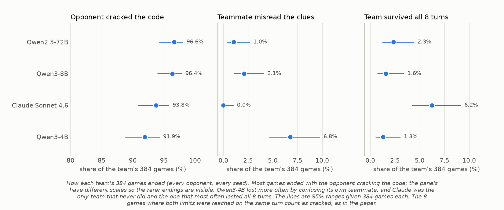

# Polaris 4-model Decrypto: the paper's competitive setup, results and comparison

Source data: `results/polaris_4model_competitive_s{0,1,2}/experiment_summary.csv`
(1,536 games = 4 teams × 4 opponents × 32 episodes × 3 seeds; jobs 7668935–7668937,
ledger in `polaris_pbs_notes.md`). Figures and every number below are regenerated by
`analysis/plot_polaris_4model_competitive.py` into
`results/polaris_4model_competitive/figures/`. The paper is Lupu, Willi & Foerster,
*The Decrypto Benchmark for Multi-Agent Reasoning and Theory of Mind*,
arXiv:2506.20664v1 (2025). Its competitive results appear **only as numbers printed in
the cells of Figure 3 (bottom row, p. 7)**, not in its text. They were transcribed from
a 300-dpi render and are listed in the appendix.

> **Roles, in plain words.** The *encoder* writes three clues for a secret 3-digit code;
> the *decoder* (its teammate) must read them back; the *interceptor* ("Eve") is a lone
> opponent trying to crack the same code. The team loses if the opponent cracks the code
> twice or the teammate misreads it twice. It wins only by lasting all 8 turns. In the
> paper's competitive setup the **same model is both encoder and decoder** (a "team"),
> playing against each model as the opponent.

## What matches the paper, and what does not

| | Paper (`config/paper/figure_3_competitive.yaml`) | This run (`config/examples/local_polaris_4model_competitive.yaml`) |
|---|---|---|
| Structure | encoder = decoder (`match_encoder_decoder: true`), every interceptor | same |
| Scale | `env_seed [0,1,2]` × `num_episodes 32` | same; one PBS job per seed. Episode seeds are `ep + env_seed × 32`, so these are the paper's game instances |
| Sampling | temperature 0.6, `model_seed 0` | same, **except Claude** (see caveats) |
| Prompts and game | this repository | same code (the paper's released prompts, Appendices I and J) |
| Players | Word2Vec, GloVe (embedding baselines), Llama-3.1-8B, Llama-3.1-70B, GPT-4o, DeepSeek-R1-Distill-Qwen-32B | Qwen2.5-72B-Instruct, Qwen3-8B, Qwen3-4B (both thinking, 2000-token reasoning budget), Claude Sonnet 4.6 via `claude -p`. **No player in common**, and no embedding baselines |
| Metrics | interception share = (intercepts + both)/32; average turns per game; mean ± standard error over the 3 seeds (`analysis/comp_cross_4heatmaps.py`) | identical definitions |

## Headline: the opponent wins almost every game, as in the paper

| How the 1,536 games ended | Games | Share [95% CI] |
|---|---|---|
| Opponent cracked the code (incl. 8 games where both limits hit on the same turn) | 1,454 | **94.7%** [93.4, 95.7] |
| Teammate misread the clues twice | 38 | 2.5% [1.8, 3.4] |
| **Team survived all 8 turns (team win)** | 44 | **2.9%** [2.1, 3.8] |

Games last **4.31 turns** on average. Losses come from *transparent clues*, not obscure
ones: interceptions outnumber miscommunications **38 : 1**. This is the regime the
paper reports: its text says "the win rate is heavily skewed in favour of Eve … with
most models rarely surviving" (Section 5). In the paper's own LLM-only block (its 4
LLMs as both teams and opponents, baselines excluded) interceptions end **90.4%** of
games and games last **4.33 turns**. Here the figures are **94.7%** and **4.31 turns**.

## Our results in the paper's format


*Each square is one match-up: a team (one model writing the clues and the same model reading them, one per row) against one opponent trying to crack the code (one per column), 32 games on each of 3 seeds. Left: share of games the opponent won by cracking the code; right: how long the games lasted. The weakest code-cracker (Qwen3-4B, third column) is the only one that lets teams last noticeably longer.*

Share of games ending in an interception (mean ± SE over 3 seeds), rows = team, columns = opponent:

| team \ opponent | Qwen2.5-72B | Qwen3-8B | Qwen3-4B | Claude Sonnet 4.6 |
|---|---|---|---|---|
| Qwen2.5-72B | 0.99 ± 0.01 | 1.00 ± 0.00 | 0.88 ± 0.04 | 1.00 ± 0.00 |
| Qwen3-8B | 0.97 ± 0.00 | 0.97 ± 0.00 | 0.92 ± 0.03 | 1.00 ± 0.00 |
| Qwen3-4B | 0.91 ± 0.00 | 0.93 ± 0.02 | 0.89 ± 0.05 | 0.96 ± 0.02 |
| Claude Sonnet 4.6 | 0.97 ± 0.02 | 0.97 ± 0.03 | 0.81 ± 0.05 | 1.00 ± 0.00 |

Average turns per game:

| team \ opponent | Qwen2.5-72B | Qwen3-8B | Qwen3-4B | Claude Sonnet 4.6 |
|---|---|---|---|---|
| Qwen2.5-72B | 4.04 ± 0.09 | 4.14 ± 0.17 | 5.57 ± 0.15 | 3.30 ± 0.07 |
| Qwen3-8B | 4.26 ± 0.12 | 4.39 ± 0.01 | 5.27 ± 0.12 | 3.43 ± 0.06 |
| Qwen3-4B | 3.91 ± 0.08 | 4.16 ± 0.17 | 4.96 ± 0.12 | 3.24 ± 0.08 |
| Claude Sonnet 4.6 | 4.68 ± 0.01 | 4.54 ± 0.09 | 5.65 ± 0.09 | 3.48 ± 0.10 |

Games survived out of 32 (the paper's Figure 7 metric):

| team \ opponent | Qwen2.5-72B | Qwen3-8B | Qwen3-4B | Claude Sonnet 4.6 |
|---|---|---|---|---|
| Qwen2.5-72B | 0.33 ± 0.33 | 0.00 ± 0.00 | 2.67 ± 0.88 | 0.00 ± 0.00 |
| Qwen3-8B | 0.67 ± 0.33 | 0.00 ± 0.00 | 1.33 ± 0.88 | 0.00 ± 0.00 |
| Qwen3-4B | 0.33 ± 0.33 | 0.00 ± 0.00 | 1.33 ± 0.33 | 0.00 ± 0.00 |
| Claude Sonnet 4.6 | 1.00 ± 0.58 | 1.00 ± 1.00 | 6.00 ± 1.53 | 0.00 ± 0.00 |

No team ever survived against Claude as the opponent (0 of 384 games). Against Qwen3-8B,
only the Claude team did, 3 times.

## Comparison with the paper


*Each dot is one model averaged over the four language models on the other side in its own study (the paper's embedding baselines left out). Blue circles: this run; gray squares: the paper. The two studies share the same overall pattern; their opponents differ, so this is not a head-to-head ranking.*

Per-model averages over the four LLMs on the other side (± propagated standard error):

| As the opponent (code-cracker): interception share | | As the team: average turns | |
|---|---|---|---|
| Claude Sonnet 4.6 | **0.990** ± 0.005 | Claude Sonnet 4.6 | **4.59** ± 0.04 |
| *GPT-4o (paper)* | *0.975* ± 0.004 | *DS-R1-Distill-32B (paper)* | *4.58* ± 0.08 |
| *DS-R1-Distill-32B (paper)* | *0.970* ± 0.008 | *GPT-4o (paper)* | *4.35* ± 0.04 |
| Qwen3-8B | 0.966 ± 0.009 | Qwen3-8B | 4.34 ± 0.04 |
| Qwen2.5-72B | 0.958 ± 0.005 | *Llama-3.1-70B (paper)* | *4.32* ± 0.05 |
| *Llama-3.1-70B (paper)* | *0.945* ± 0.011 | Qwen2.5-72B | 4.26 ± 0.06 |
| Qwen3-4B | 0.872 ± 0.021 | *Llama-3.1-8B (paper)* | *4.08* ± 0.09 |
| *Llama-3.1-8B (paper)* | *0.725* ± 0.024 | Qwen3-4B | 4.07 ± 0.06 |

What carries over from the paper:

1. **The opponent dominates in both studies.** No LLM team here or in the paper averages
   more than 4.6 turns against LLM opponents. Human teams in the paper's Table 1 lasted
   **6.90 turns and won 40%** of their 10 games against Llama-3.1-70B as Eve. Replayed
   against the paper's strongest interceptors (DeepSeek-R1; Claude 3.7 Sonnet with
   extended thinking), their clues still lasted 6.27–6.30 turns with a 20% win rate.
   The gap to humans is a property of the LLMs, as the paper argues, and it persists
   with 2026 models.
2. **A clearly weakest code-cracker in each study, and it is the one that lets games
   run long.** Qwen3-4B here (0.87; 4.96–5.65 turns against it) and Llama-3.1-8B in the
   paper (0.73; 5.17–5.93 turns against LLM teams). The rest of each study's opponents
   sit within a few points of each other (0.958–0.990 here, 0.945–0.975 in the paper).
3. **The strongest code-cracker also produces the shortest games.** Claude as the
   opponent ended games in 3.24–3.48 turns. The paper's GPT-4o, its strongest Eve, ended
   them in 3.40–3.94 (mean 3.60), the shortest of its LLM opponents.
4. **The best team lasts about 4.6 turns.** Claude here (4.59) and the paper's
   DeepSeek-R1-Distill-32B (4.58), its best LLM team, are the longest-lasting teams in
   their studies.

What does *not* carry over cleanly:

- **The paper's "larger models perform better" gradient is not visible inside our Qwen
  set.** Qwen2.5-72B is not better than Qwen3-8B in either role (0.958 vs 0.966 as
  opponent; 4.26 vs 4.34 turns as team). They differ in generation and in thinking mode,
  not only in size, so this is not evidence against the paper's claim. Only the smallest
  model, Qwen3-4B, stands out (lower in both roles).
- **The paper's headline that embedding baselines beat every LLM cannot be checked
  here**, because the baselines were not run (their embedding data is not staged).

## How each team's games ended



*How each team's 384 games ended, on three separate scales. Qwen3-4B lost more often by confusing its own teammate; Claude never did, and lasted all 8 turns most often. Lines are 95% ranges.*

| Team | Opponent cracked the code | Teammate misread the clues | Survived all 8 turns |
|---|---|---|---|
| Qwen2.5-72B | 371 (96.6%) | 4 (1.0%) | 9 (2.3%) |
| Qwen3-8B | 370 (96.4%) | 8 (2.1%) | 6 (1.6%) |
| Qwen3-4B | 353 (91.9%) | **26 (6.8%)** | 5 (1.3%) |
| Claude Sonnet 4.6 | 360 (93.8%) | **0 (0.0%)** | **24 (6.2%)** [4.2, 9.1] |

(Counts out of 384 per team; 1 Qwen2.5-72B and 7 Qwen3-4B games hit both limits on the
same turn and are counted as cracked, as in the paper.) Qwen3-4B's lower interception
rate as a team is **not** better secrecy: more of its games end first by miscommunication.
Claude is the only team with zero miscommunications. It survived about 3–5× as often as
the Qwen teams, but even that is 24 of 384 games.

## Caveats (read before citing any number)

- **No player is shared with the paper.** The comparison is of the overall regime and of
  where models fall, not a leaderboard across studies. Each per-model average depends on
  its own study's opponent pool: ours includes the weak Qwen3-4B, the paper's includes
  the weak Llama-3.1-8B.
- **Claude did not play under the paper's sampling settings.** It ran through the
  headless `claude -p` CLI, which accepts no temperature or token limit. The config's
  `temperature: 0.6` and `max_tokens: 750` were not applied, and Claude sampled at the
  CLI default. The CLI path also sends the conversation as one flattened transcript with
  `[USER]`/`[ASSISTANT]` markers, not as a native message list. Every Qwen model ran at
  temperature 0.6 with native chat messages.
- **73 Claude calls hit the 180 s CLI timeout** (40/15/18 by seed). Each returned no
  answer and went through the game's retry path. That is a small handicap specific to
  Claude.
- **Error history: the paper's text and its released config disagree.** Appendix F.1
  says retries are by default *not* added to the model's context. The released
  `figure_3_competitive.yaml` leaves `no_error_history` at its code default `false`,
  which *keeps* failed attempts and the `[GAME_MASTER]` re-prompts in context
  (`src/agents/role_client.py:490`). This run follows the released config. Retries were
  rare (on average 0.037 per encoder turn and 0.004 per decoder or interceptor turn), so
  the difference touches few turns.
- **Qwen3 thinking budget.** 10 HTTP 400 context-length errors (all Qwen3-8B as encoder,
  seed 2: e.g. a 6,268-token prompt + the 2,000-token reasoning budget > 8,192), and 9 encoder turns in 1,536 games
  exhausted all retries and played the default `no_hint` clues (all Qwen3 teams). The
  paper used generous limits (750 for plain models, up to 10,000 for reasoning models)
  and reports models rarely reached them.
- **Three seeds.** The ± values are standard errors over 3 seeds, so they are rough; a
  "± 0.00" means identical outcomes on all three seeds, not certainty. The pooled
  percentages use 95% Wilson intervals over games.
- **The paper's Figure 7 caption says "standard deviation"**, but its values are
  standard errors (0.33 ± 0.33 is three seeds of 0, 0, 1). Both studies' figures are
  therefore on the same SE footing.
- **Transcription.** The paper's values come from the numbers printed in its figure
  cells (2 decimals) and were read from a 300-dpi render. They are listed in the
  appendix so they can be checked against the PDF.
- **Seed 2 was preempted 8 times on the `preemptable` queue.** The runner cannot resume,
  so its CSV comes from the final, uninterrupted attempt, not a mix of attempts.

## Reproduce

```bash
BASE=/lus/eagle/projects/lighthouse-uchicago/members/mehta5
# the run (one job per seed; see polaris_pbs_notes.md for queue notes)
for s in 0 1 2; do
  qsub -q preemptable -l walltime=12:00:00 \
    -v CONFIG_NAME=local_polaris_4model_competitive,EXP_NAME=polaris_4model_competitive_s$s,SEEDS=$s,DECRYPTO_MAX_WORKERS=16 \
    slurm/fused_4model_polaris.pbs
done
# figures + tables
$BASE/conda-envs/decrypto-serve/bin/python analysis/plot_polaris_4model_competitive.py
```

## Appendix: the paper's competitive values (arXiv:2506.20664v1)

Figure 3, bottom row (p. 7): rows = team (encoder = decoder), columns = interceptor;
mean ± SE over 3 seeds, 32 games each.

Share of games ending in an intercept:

| team \ interceptor | Word2Vec | GloVe | Llama-8B | Llama-70B | GPT-4o | DS-R1-32B |
|---|---|---|---|---|---|---|
| Word2Vec | 1.00 ± 0.00 | 1.00 ± 0.00 | 0.48 ± 0.05 | 0.85 ± 0.01 | 0.99 ± 0.01 | 0.88 ± 0.00 |
| GloVe | 1.00 ± 0.00 | 1.00 ± 0.00 | 0.38 ± 0.05 | 0.85 ± 0.03 | 0.94 ± 0.00 | 0.92 ± 0.03 |
| Llama-8B | 0.88 ± 0.04 | 0.95 ± 0.01 | 0.71 ± 0.08 | 0.89 ± 0.01 | 0.92 ± 0.01 | 0.94 ± 0.02 |
| Llama-70B | 0.99 ± 0.01 | 0.98 ± 0.02 | 0.71 ± 0.02 | 0.98 ± 0.01 | 1.00 ± 0.00 | 0.99 ± 0.01 |
| GPT-4o | 1.00 ± 0.00 | 1.00 ± 0.00 | 0.77 ± 0.01 | 0.96 ± 0.01 | 1.00 ± 0.00 | 1.00 ± 0.00 |
| DS-R1-32B | 0.97 ± 0.00 | 0.96 ± 0.01 | 0.71 ± 0.05 | 0.95 ± 0.04 | 0.98 ± 0.01 | 0.95 ± 0.02 |

Average turns per episode:

| team \ interceptor | Word2Vec | GloVe | Llama-8B | Llama-70B | GPT-4o | DS-R1-32B |
|---|---|---|---|---|---|---|
| Word2Vec | 4.34 ± 0.05 | 4.59 ± 0.07 | 7.00 ± 0.09 | 6.03 ± 0.11 | 4.66 ± 0.16 | 5.44 ± 0.08 |
| GloVe | 4.45 ± 0.09 | 4.25 ± 0.05 | 7.28 ± 0.13 | 5.38 ± 0.06 | 4.92 ± 0.04 | 5.30 ± 0.14 |
| Llama-8B | 4.25 ± 0.02 | 4.25 ± 0.08 | 5.17 ± 0.26 | 3.80 ± 0.22 | 3.46 ± 0.06 | 3.88 ± 0.03 |
| Llama-70B | 4.33 ± 0.06 | 4.39 ± 0.05 | 5.93 ± 0.12 | 4.01 ± 0.12 | 3.40 ± 0.06 | 3.94 ± 0.11 |
| GPT-4o | 4.46 ± 0.06 | 4.50 ± 0.11 | 5.77 ± 0.08 | 4.15 ± 0.03 | 3.59 ± 0.05 | 3.90 ± 0.11 |
| DS-R1-32B | 4.70 ± 0.05 | 4.62 ± 0.05 | 5.77 ± 0.22 | 4.33 ± 0.22 | 3.94 ± 0.05 | 4.27 ± 0.12 |

Figure 7, left (p. 18): games survived out of 32 (DS-R1-32B not shown in the paper):

| team \ interceptor | Word2Vec | GloVe | Llama-8B | Llama-70B | GPT-4o |
|---|---|---|---|---|---|
| Word2Vec | 0.00 ± 0.00 | 0.00 ± 0.00 | 16.67 ± 1.45 | 4.67 ± 0.33 | 0.33 ± 0.33 |
| GloVe | 0.00 ± 0.00 | 0.00 ± 0.00 | 20.00 ± 1.53 | 4.67 ± 0.88 | 2.00 ± 0.00 |
| Llama-8B | 0.33 ± 0.33 | 0.00 ± 0.00 | 5.67 ± 2.19 | 0.33 ± 0.33 | 0.00 ± 0.00 |
| Llama-70B | 0.00 ± 0.00 | 0.00 ± 0.00 | 8.33 ± 1.20 | 0.33 ± 0.33 | 0.00 ± 0.00 |
| GPT-4o | 0.00 ± 0.00 | 0.00 ± 0.00 | 7.33 ± 0.33 | 1.33 ± 0.33 | 0.00 ± 0.00 |

Table 1 (p. 8), human teams: 10 original games against Llama-3.1-70B-Instruct as Eve,
11 miscommunications, 12 intercepts, **40.00%** win rate, **6.90** game length. Replaying
the same human clues against other interceptors gave win rates from 46.67% (Llama-3.1-8B,
Llama-3.1-70B) down to 20.00% (GloVe; DeepSeek-R1; Claude 3.7 with extended thinking),
with game lengths of 6.27–7.00.
